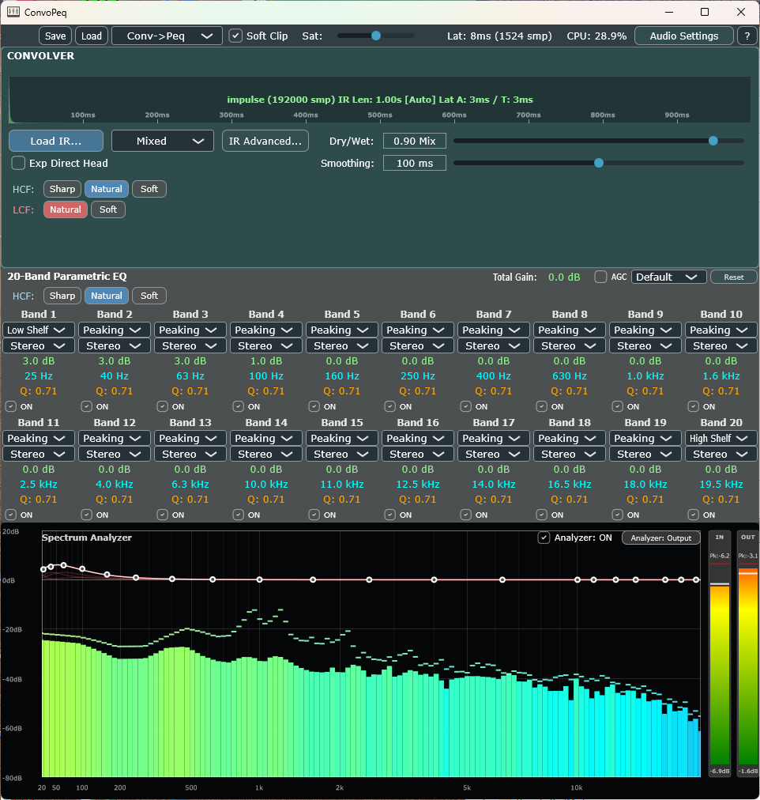

# ConvoPeq   - powered by Vibe-Coding

---

---

## Compatibility notice — oversampling gain (next release)

**Gain convention change (default).** The input oversampler now has unity round-trip gain. Before this change the gain was 0.75 / 0.5625 / 0.421875 at 2× / 4× / 8× (−2.50 / −5.00 / −7.50 dB). Projects made with earlier versions therefore play 2.5–7.5 dB louder at unchanged settings; preset values are not modified. Check output make-up gain and limiter activity after updating. `-DCONVOPEQ_CORRECT_POLYPHASE_GAIN=OFF` restores the old behaviour.

## New in v0.6.12

1. Made the convolver bypass transition tail-preserving: the bypass now crossfades over a dedicated 20 ms window instead of cutting the wet tail, restarts from the current mix after an interrupted fade, and leaves the reported latency and host PDC unchanged, with an N1 audio analysis and pre/post comparison checked in as evidence.
2. Hardened the EQ coefficient cache: the key now normalizes disabled bands to zero and keeps the gain sign, collision probing was widened to 64 slots, restored EQ inputs reject non-finite values before they reach the runtime, and the duplicated phase-unwrap path is shared.
3. Strengthened ISR/EBR reader and retire lifetimes: non-RT EQ state readers take a scoped epoch slot, the epoch reader is entered before the published world is loaded, pinning resolves through the registered slot rather than instance visibility, and new V11 engine-retire/reader-reacquire tests plus the STG-8/STG-10 additions pin the contract.
4. Unified the corrupt-sample boundary: a single 2^53 magnitude limit defined in `CorruptSampleGuard.h` is now shared by the scalar and AVX2 guards, non-finite input can no longer enter the true-peak FIR history, and the true-peak regression coverage was extended.
5. Added the RT measurement path, mixed-phase cache v3 and build tooling: a fixed-length RT measurement ring with a non-RT aggregator (modes 0/2/1, 1 s drain), the v3 persistent-cache namespace with state/sample-rate/failure coverage, an app-only `build.bat` target, and the clangd compilation database, header ODR check, preflight verifiers, oneAPI-cached Windows Release check and CI gating of the audio test.

## Overview

ConvoPeq v0.6.12 is built with JUCE 8.0.12 and is designed for low-latency, real-time-safe operation on Windows. All DSP runs in 64-bit double precision with AVX2 acceleration, backed by Intel oneMKL and IPP.

| Aspect | Detail |
|--------|--------|
| Platform | **Windows 11 x64** (standalone, not a plugin) |
| Framework | **JUCE 8.0.12** |
| Compilers | **MSVC 19.44+** (VS2022 17.11+ or VS2026) / **Intel icx** (oneAPI 2026.0) |
| DSP Precision | **64-bit double** throughout the main processing path |
| SIMD / Math | **AVX2** + **Intel oneMKL** (sequential, static link) + **Intel IPP** |
| Build System | **CMake 3.22+** + **Ninja Multi-Config** |
| Language | **C++20** |
| Source | **385 files** (~6.11 MB) across `src/` + 53 test executables (97 test source files) |

### Compiler / CPU support matrix (work92 C-8)

| Build | AVX2 flag | Floating point | AMD CPU execution |
|-------|-----------|----------------|-------------------|
| **MSVC Release** | `/arch:AVX2` (target-local) | `/fp:precise` (MSVC default — `fp:fast` removed in work92) | **Supported** — standard AVX2 codegen (AMD Ryzen 全対応) |
| **MSVC Debug** | `/arch:AVX2` (target-local, applied in every configuration) | — | **Supported** |
| **icx Release** | `/QxCORE-AVX2` (Release + CXX only, target-local) | `/fp:fast` (intentional — LLVM OOM workaround, see CMakeLists) | **Unsupported (not officially tested)** — representative DSP loops verified to stay within the AVX2 subset (no Intel-only instructions such as vpcompressd/zmm/gather/kmov; G6 audit 2026-09-09), but full-binary AMD compatibility is not guaranteed. Execution may work, but is not a supported configuration. |
| **icx Debug / RWDI** | *no build support* | — | **Not supported — does not compile.** `/QxCORE-AVX2` is config-gated to Release (work92 C-8) while AVX2 intrinsics remain unguarded in 16+ non-test sources (e.g. `AudioEngine.EQResponse.cpp` `_mm256_*`), so clang-based icx hard-errors (`always_inline ... requires target feature 'avx'`). E-G3-1 pre-audit 2026-09-13: `.auto/rb/eg3_1_icx_debug_avx_preaudit_20260913.md`. Debug acceptance is provided by MSVC `build/` (54/54 CTest). |

> **Policy (E-G3-1, option a — accepted 2026-09-13):** the icx ConvoPeq build is **officially supported for Release only**. Do not attempt `build.bat Debug icx` / RelWithDebInfo under icx; if Debug-level icx verification is ever required, it is a separate work item that must first resolve the config-gate vs unguarded-intrinsic inconsistency (options b/c in the E-G3-1 audit).

---

## Documentation

- [README.md](README.md): User-facing overview, features, audio processing summary, and build entry points
- [ARCHITECTURE.md](ARCHITECTURE.md): Developer-facing architecture, threading, state flow, and subsystem design details
- [SOUND_PROCESSING.md](SOUND_PROCESSING.md): **In-depth, code-referenced technical documentation of the entire audio signal processing flow.**
  - Covers all DSP stages (input, conditioning, oversampling, main DSP chain, output, dither, etc.)
  - Includes mathematical formulas, buffer/parameter management, SIMD/real-time safety, and code path examples
  - Intended for international contributors and advanced users seeking a rigorous technical reference
- [BUILD_GUIDE_WINDOWS.md](BUILD_GUIDE_WINDOWS.md): Windows build instructions and troubleshooting
- [HOW_TO_USE.md](HOW_TO_USE.md): Practical usage guide — room correction via IR convolution with REW, and headphone EQ correction via AutoEq

### ISR Design & Audit Docs ([doc/work/](doc/work/))

The `doc/work/` directory contains ~82 ISR design documents covering the full ISR development lifecycle (Phases 0–4, Bridge Runtime, Rebuild Admission, EpochDomain migration, Shutdown State Machine, and formal compliance audits). Key entry points:

- [doc/work/ISR_Rebuild_Admission_最終計画書_2026-05-23.md](doc/work/ISR_Rebuild_Admission_最終計画書_2026-05-23.md): 実装計画と受入基準（8章）
- [doc/work/ISR_Rebuild_Admission_受入基準クローズログ_2026-05-23.md](doc/work/ISR_Rebuild_Admission_受入基準クローズログ_2026-05-23.md): 実測ログ付きのクローズ判定台帳
- [doc/work/R11-R25_Closed判定監査表_2026-05-21.md](doc/work/R11-R25_Closed判定監査表_2026-05-21.md): R11〜R25監査の正本

### Companion Analysis

- [doc/sourcecode_analysis_2026-07-03.md](doc/sourcecode_analysis_2026-07-03.md): Complete source code structure analysis (25 sections, all data flows)

### Manuals ([manual/](manual/))

**English Manuals:**

- [manual/MAIN_WINDOW_EN.md](manual/MAIN_WINDOW_EN.md): Main window usage (English)
- [manual/AUDIO_SETTINGS_WINDOW_EN.md](manual/AUDIO_SETTINGS_WINDOW_EN.md): Audio settings window (English)
- [manual/IR_ADVANCED_WINDOW_EN.md](manual/IR_ADVANCED_WINDOW_EN.md): IR advanced window (English)
- [manual/ADAPTIVE_NOISE_SHAPER_LEARNING_WINDOW_EN.md](manual/ADAPTIVE_NOISE_SHAPER_LEARNING_WINDOW_EN.md): Adaptive Noise Shaper Learning (English)

**Japanese Manuals (in Japanese):**

- [manual/MAIN_WINDOW_JP.md](manual/MAIN_WINDOW_JP.md): Main window usage (Japanese)
- [manual/AUDIO_SETTINGS_WINDOW_JP.md](manual/AUDIO_SETTINGS_WINDOW_JP.md): Audio settings window (Japanese)
- [manual/IR_ADVANCED_WINDOW_JP.md](manual/IR_ADVANCED_WINDOW_JP.md): IR advanced window (Japanese)
- [manual/ADAPTIVE_NOISE_SHAPER_LEARNING_WINDOW_JP.md](manual/ADAPTIVE_NOISE_SHAPER_LEARNING_WINDOW_JP.md): Adaptive Noise Shaper Learning (Japanese)

### Directory Map (ASCII Tree)

```text
ConvoPeq/
├── src/                       # Main C++ source (385 files, ~6.11 MB)
│   ├── audioengine/           # ISR runtime governance, AudioEngine split TU (128 files)
│   │   ├── AudioEngine.Processing.*.cpp  # Audio thread core (DSPCore, Block, Latency)
│   │   ├── AudioEngine.*.cpp            # Lifecycle, Timer, Commit, Rebuild, Retire
│   │   └── ISR*.cpp                     # Closure, HB, Shutdown, Publication, Retire, etc.
│   ├── eqprocessor/           # 20-band EQ split + Analysis Subsystem (17 files)
│   │   ├── EQProcessor.{Core,Coefficients,Parameters,Processing,ProcessingCache}.cpp
│   │   └── PeakEstimator, UpperBoundEstimator, EQResponseSampler, BandHelper,
│   │        AnalysisMerge, EQAnalysisMath, EQAnalysisTypes (analysis subsystem)
│   ├── convolver/             # Convolution split TU (12 files)
│   │   └── ConvolverProcessor.{Lifecycle,Rebuild,LoaderThread,LoadPipeline,MixedPhase,
│   │                           ResampleAndFallback,Runtime,StateAndUI}.cpp,
│   │       Internal.h, LoaderThreadInline.h, IRLoadAdmission.h, IRTrimTestHooks.h
│   ├── core/                  # RCU snapshot foundation (41 files)
│   │   ├── EpochDomain.h      # 64-slot named reader domain (35.6 KB)
│   │   ├── RCUReader.h, SnapshotCoordinator, GlobalSnapshot, DeletionQueue, FadeEngine
│   │   ├── WorkerThread, Types, CommandBuffer, SnapshotSlotStore, SnapshotRetireManager
│   │   └── IEpochProvider, IPublicationProvider, IRetireRouter (Provider pattern)
│   ├── dsp/math/              # FastTanhApprox.h (AVX2 tanh approximation)
│   ├── tools/                 # Build identity gate + layout offset check (Python)
│   └── tests/                 # CTest regression suite (97 files, 53 executables)
├── config/                    # JSON authority manifests (4 files)
├── tools/                     # Build/verify scripts (81 .py + 54 .bat + 2 .cmd)
├── doc/                       # Architecture work docs (~82 ISR design files)
│   ├── work/                  # ISR design, audit, compliance
│   └── sourcecode_analysis_2026-07-03.md  # Full source analysis
├── manual/                    # User manuals (EN/JP, 4 topics each)
├── .github/                   # CI workflows, ISR policies, scripts (268 files)
├── .vscode/                   # tasks.json (77 entries), launch.json (5 configs)
├── resources/                 # App resources (icons, assets)
├── sampledata/                # Sample IR/EQ files
├── JUCE/                      # JUCE 8.0.12 framework source (in-tree)
├── r8brain-free-src/          # IR resampler (external dependency)
├── CMakeLists.txt             # Build configuration (2,583 lines, v0.6.12)
├── CMakePresets.json          # 3 configure + 2 build presets
├── build.bat                  # Primary build script (MSVC + icx, 358 lines)
├── ProjectMetadata.cmake      # App name, version (v0.6.12), company
├── README.md                  # This file
├── ARCHITECTURE.md            # Architecture & ISR governance (v0.6.12)
├── SOUND_PROCESSING.md        # Complete signal processing guide
├── BUILD_GUIDE_WINDOWS.md     # Windows build instructions
└── HOW_TO_USE.md              # Practical usage guide (REW + AutoEq)
```

---

## Key Features

### Core DSP
- **20-band parametric EQ** (`EQProcessor`, split TU: 17 files in `src/eqprocessor/` incl. analysis subsystem)
  - TPT (Topology-Preserving Transform) State Variable Filters per band
  - `EQBandType`: LowShelf / Peaking / HighShelf / LowPass / HighPass
  - `EQChannelMode`: Stereo / Left / Right / Mid / Side (M/S processing)
  - Filter structure: **Serial** (default) or **Parallel**
  - Auto Gain Control (AGC): attack 0.2 s, release 2.0 s, smooth 0.2 s
  - Nonlinear saturation via `fastTanh` rational approximation (no libm)
  - `EQCoeffCache`: hash-keyed shared coefficient cache (v2.3); ownership sits in `DSPHandleRuntime`, there is no refcount
- **IR convolution** (`ConvolverProcessor`, split TU: 12 files in `src/convolver/`)
  - Intel MKL **Non-Uniform Partitioned Convolution (NUC)** engine
  - FFT abstraction: `ConvolverBuilder` → `FFTBackend` (IPP ProductionFft / TestFft) → `FFTExecutionContext`
  - Phase modes: **As-Is / Minimum / Mixed** with a tunable transition band (`mixedTransitionStartHz`, default 200 Hz, to `mixedTransitionEndHz`, default 1 kHz) and an all-pass `tau`
  - IR loading on dedicated background `LoaderThread` — no audio thread blocking
  - RCU (Read-Copy-Update) pattern for glitch-free IR handoff
  - `MKLNonUniformConvolver.{h,cpp}` is the active NUC engine (`nucConvolvers[2]` in `ConvolverProcessor`)
- **Runtime-selectable processing order**: EQ→Convolver or Convolver→EQ
- **Input oversampling**: 2×/4×/8× via `CustomInputOversampler` (IIRLike / LinearPhase presets), with unity round-trip gain (corrected polyphase gain convention, default since Part 8 E)
- **Output conditioning**: `OutputFilter` applied per active stage — HC/LC on the convolver output and HPF/LPF on the EQ output, independent of processing order — then makeup gain followed by musical soft clipping with `fastTanh` (AVX2 vectorized)

### Noise Shaping & Dithering
- **PsychoacousticDither**: 12th-order error-feedback (GUI entry "12th-order"), MKL VSL RNG + TPDF, `kCoeffTable[6][3][12]` per sample rate and bit depth
- **FixedNoiseShaper**: 4th-order error-feedback, psychoacoustically tuned coefficients
- **Fixed15TapNoiseShaper**: 16th-order error-feedback (class name "15Tap" for legacy consistency, ORDER = 16)
- **Adaptive 9th-order** (`NoiseShaperLearner`, 79.8 KB): lattice-ladder noise shaper with CMA-ES optimization on a dedicated worker thread, RCU coefficient handoff, per-(sample rate, bit depth, mode) banks, 6 learning modes (Shortest / Short / Middle / Long / Ultra / Continuous)

### Analysis & Metering
- **Real-time spectrum analyzer** with EQ overlay (`SpectrumAnalyzerComponent`, 59.0 KB)
- **LoudnessMeter**: ITU-R BS.1770-4/5 K-weighting (2-stage biquad), lock-free ring buffer publish to worker thread
- **TruePeakDetector**: 4× oversampled true peak (63-tap linear phase FIR, ITU-R BS.1770-3)
- **DC blocking**: `UltraHighRateDCBlocker` at three points — input (3 Hz), post-upsampling at the processing rate (1 Hz), and output (3 Hz)

### I/O & Device Support
- Standalone runtime with **ASIO / WASAPI / DirectSound** device support
- Persistent device settings (`device_settings.xml`)
- `AsioBlacklist.h` for known broken ASIO drivers

### ISR Runtime Governance (128 files in `src/audioengine/`)
- **RCU + atomic** parameter handoff (`publishAtomic` / `consumeAtomic` primitives)
- **EpochDomain** (64 named reader slots) + `RCUReader` RAII pattern
- Publication choreography: `ISRRuntimePublicationCoordinator`, `PublicationAdmission`, `RuntimePublishExecutor`
- Retire pipeline: `DSPLifetimeManager` → `ISRRetireRouter` → `DeletionQueue` (+ `RetireQuarantineStore` fallback)
- Crossfade governance: `CrossfadeAuthority` / `CrossfadeRuntime` (Authority pattern)
- Health monitoring: `RuntimeHealthMonitor`, `RuntimePolicyEngine`
- Build resilience: `BuildErrorPolicy` (Permanent/Transient/Infrastructure/Fatal) + `RetryScheduler`
- Deferred garbage collection: `DeferredDeletionQueue`, `RefCountedDeferred`, `DeferredFreeThread`

### Build & Test Infrastructure
 - **CTest regression suite**: 53 test executables (54 `add_test` entries — ISR identity, publication coordinator, semantic validation, grace semantics, MPSC ring, retry scheduler, FFT backend, etc.)

---

## Audio Processing Method

This section is a user-facing summary of the current block processing strategy. For in-depth, code-referenced technical documentation (DSP stages, mathematical formulas, SIMD/real-time safety, code path examples), see `SOUND_PROCESSING.md`. For subsystem-level architectural details, threading model, RCU patterns, and ISR governance, see `ARCHITECTURE.md`.

### 1) Quality-Oriented Design Principles

ConvoPeq is designed to preserve fidelity under real-time conditions.

- **64-bit double-precision DSP** throughout the main processing path — reduces cumulative rounding error across cascaded stages.
- **All heavy preparation is moved off the audio thread**: filter coefficient computation (`std::sin`/`std::cos`), IR loading/resampling, noise shaper coefficient learning (CMA-ES), and state validation occur on message/worker threads.
- **SIMD (AVX2/FMA) + Intel oneMKL acceleration** are used where throughput matters: `scaleBlockFallback`, `softClipBlockAVX2`, FIR convolution in oversampling stages, Intel IPP FFT for the real-time convolution (MKL DFTI serves the analyzer FFT and offline IR phase/resample work), VSL RNG for dither generation.
- **Transition-safe state changes**: all parameter handoff uses atomic publish/consume or RCU (Read-Copy-Update) with `EpochDomain` — no clicks, zipper noise, or abrupt latency jumps.

### 2) Block Entry and State Snapshot

For each callback block, `AudioEngine::processBlockDouble()` enters the audio thread with:

```cpp
AudioCallbackRuntimeScope (lifecycleToken + firewallToken)
ensureThreadFloatingPointEnvironment()   // FTZ/DAZ set once per thread, no per-block save/restore
ThreadRole::AudioRealtime      // numeric policy verification
```

The `ProcessingState` snapshot is assembled from atomic reads and RCU-published shared state at block start. The entire block is then processed using only this **read-only, consistent snapshot** — no blocking operations, no parameter races, no allocation.

### 3) Main DSP Chain

Typical logical flow (exact sequence from `SOUND_PROCESSING.md`):

```
Input → Headroom Gain → Input DC Block → Oversampling (optional, + OS-rate DC block) →
[EQ ↔ Convolver] (order selectable; HC/LC follows the convolver, HPF/LPF follows the EQ) →
Makeup Gain → Soft Clip (musical, fastTanh, AVX2) →
Downsampling (if OS) → Output DC Block → Dither/Noise Shaping → TruePeak/LUFS metering →
Peak Limiter (−0.5 dB, 1 dB knee) → Hard Clamp (±1 dBFS) → Fixed Latency Delay → Output
```

- **Order is runtime-selectable**: EQ→Convolver or Convolver→EQ.
- Oversampling factor: 1×/2×/4×/8× (IIRLike or LinearPhase preset).
- Input headroom gain and output makeup gain are AVX2-optimized, gain values pre-converted to linear in the message thread (no `std::pow` on audio thread).
- Convolver input trim is applied only when the processing order is **EQ→Convolver** (the convolver itself must be active; the EQ need not be).

### 4) Convolution Strategy

`ConvolverProcessor` (split TU, 12 files in `src/convolver/`) uses asynchronous IR preparation and RCU-based safe handoff:

- **IR load/rebuild** is handled by a dedicated `LoaderThread` (`juce::Thread`) — audio thread never blocks on file I/O or IR resampling.
- **Rebuild requests are debounced** (`REBUILD_DEBOUNCE_DEFAULT_MS`) to reduce burst load from rapid parameter changes.
- **RCU handoff**: new IR state atomically swapped; audio thread continues with old IR without interruption. Old engines retired via `ISRRetireRouter` → `DeletionQueue`.
- **Latency retargeting** uses a 2-sample threshold (`kLatencyRetargetThresholdSamples`) plus a smoother, so small latency changes do not retrigger the engine.
- User-facing controls are debounced to avoid unnecessary rebuild pressure during UI dragging.

Convolution algorithm: **Intel MKL NUC (Non-Uniform Partitioned Convolution)** with non-uniform block partitioning (shorter blocks near IR start for low latency, longer blocks toward the tail for efficiency). FFT operations use the `ConvolverBuilder` → `FFTBackend` (Intel IPP) → `FFTExecutionContext` abstraction layer.

Phase modes: **As-Is / Minimum / Mixed**. Mixed mode is **minimum phase at low frequencies and linear phase at high frequencies**: below `mixedTransitionStartHz` (default 200 Hz) the minimum-phase component has full weight, above `mixedTransitionEndHz` (default 1 kHz) it has none, with an all-pass `tau` shaping the transition.

### 5) EQ Strategy

`EQProcessor` (split TU, 17 files in `src/eqprocessor/`) applies per-band parametric filtering in real time:

- **20-band TPT (Topology-Preserving Transform) SVF** based on Vadim Zavalishin's "The Art of VA Filter Design" — smooth parameter modulation, low noise.
- **RCU-based coefficient handoff**: UI/worker thread creates new `EQState` / `BandNode`, publishes via `publishAtomic(currentStateBits, ...)`. Audio thread loads via `loadCurrentState(acquire)`.
- **EQCoeffCache**: hash-keyed shared coefficient cache — multiple snapshots share coefficients when parameters are identical (ownership in `EQCacheManager` → `DSPHandleRuntime`; no refcount).
- **Nonlinear saturation**: `fastTanh` rational polynomial approximation applied per-sample within the SVF loop (no `libm`, branchless for |x| < CLIP_THRESHOLD).
- **AGC** (Auto Gain Control): envelope-tracking automatic gain adjustment with precomputed attack/release/smooth coefficient lookup tables.
- **M/S (Mid-Side) processing**: supports per-band Left/Right/Mid/Side channel modes via `kFilterChannels=4`.

### 6) Oversampling, Output Conditioning, and Finalization

Additional quality-oriented stages applied around the core EQ/convolution chain:

- **Input oversampling** (`CustomInputOversampler`): 2×/4×/8× via multi-stage Kaiser-windowed FIR interpolation, AVX2/FMA SIMD, denormal flush. DC blocker applied after upsampling.
- **Output filtering** (`OutputFilter`): applied per active stage, not by routing position. HC/LC runs exactly once on the convolver output whenever the convolver is active (HC: 4th-order Butterworth, 4th-order Linkwitz-Riley, or 2nd-order Q=0.5 at 19 kHz up to 48 kHz and 22 kHz above; LC: 2nd-order HPF at 18 Hz, or Q=0.5 at 15 Hz). HPF/LPF runs after the EQ whenever the EQ is active (HPF 20 Hz 2nd-order; LPF two cascaded 2nd-order sections at 19 kHz up to 48 kHz and 24 kHz above). All coefficients precomputed on the message thread; the audio thread performs only biquad SOS evaluation (no `libm`).
- **Soft clipping** (`softClipBlockAVX2`): piecewise musical clip (linear → knee `t²(3−2t)` → `fastTanh` saturation), AVX2 vectorized (4 doubles/IP), with a local 2× halfband stage when input oversampling is 1×. Anti-inter-sample-peak protection via the smooth knee transition.
- **Dither/noise shaping**: 4 types (Psychoacoustic 12th-order / Fixed 4th-order / Fixed 15th-order GUI label, internally ORDER=16 / Adaptive 9th-order with CMA-ES). All TPDF dither, lock-free audio thread path with no allocation; coefficient tables are 64-byte aligned. The RNG ring buffer is pre-filled from the timer thread.

### 7) Analyzer Path

Analyzer data is decoupled from output audio:

- Audio thread pushes analyzer source data to `LockFreeRingBuffer` (SPSC, 64-byte aligned, atomic head/tail).
- UI timer reads FIFO and runs FFT visualization (`SpectrumAnalyzerComponent`).
- Analyzer update rate is adaptive by state (active/disabled/hidden) to limit UI-thread load.

This separation ensures visualization quality does not compromise audio-thread safety.

### 8) Latency Reporting

Latency display uses a unified breakdown model from `AudioEngine::getCurrentLatencyBreakdown()`:

- **Oversampling latency**: base-rate estimated from FIR tap counts per stage (IIRLike: 511/127/31, LinearPhase: 1023/255/63).
- **Convolver algorithm latency** + **IR peak latency**: reported from `ConvolverProcessor::getLatencyBreakdown()`.
- **SoftClip local OS latency**: 15 base-rate samples (31-tap halfband, up + down pass) when input oversampling is 1×; reported as 0 when input oversampling is active.
- All values reported in both `ms` and `samples` from `totalLatencyBaseRateSamples`.

### 9) State Persistence

Two persistence paths:

- **Auto-save** (`device_settings.xml`): device state plus compact runtime settings (dither bit depth and shaper type, oversampling factor/type, input headroom, output makeup, auto gain staging, thread priority mode, learned coefficient banks).
- **Manual preset XML** (Save/Load Preset): engine properties (processing order, gains, saturation, bypasses, filter modes, adaptive banks) plus the `EQ` and `Convolver` child states, including phase mode, `mixedF1Hz`/`mixedF2Hz`, IR length and its auto/manual override. The oversampling factor itself stays a device setting.

### 10) Real-Time Safety Rules

The audio callback path avoids:

- file I/O, blocking locks/waits,
- heavy runtime allocations (`malloc`/`new`/`resize`),
- `libm` calls (`std::sin`/`std::cos`/`std::pow`/`std::log`/`std::exp`),
- exceptions, UI thread interactions,
- `std::condition_variable` waits.

Buffers and heavy state are prepared outside the callback (`prepareToPlay()`). Old resources are garbage collected asynchronously (`DeferredDeletionQueue`, `RefCountedDeferred`, `DeferredFreeThread`).

In practice, ConvoPeq aims for both:

- **high sound quality**: double-precision DSP, long-form convolution (MKL NUC), oversampling, TPT SVF EQ, psychoacoustic noise shaping, ITU-R BS.1770 metering, and
- **stable real-time behavior**: asynchronous preparation, debounce, RCU state handoff, ISR runtime governance, and callback-safe processing boundaries.

---

## Project Scope

- Standalone desktop application
- Windows-only runtime target
- Real-time audio processing with separate UI/analyzer pipeline

## Build Requirements

1. **Visual Studio 2022 (17.x) or 2026 (18.x)** with *Desktop development with C++* workload
   - Alternatively: **Intel icx** compiler (oneAPI 2026.0) — no VS required for icx mode
2. **CMake 3.22+**
3. **Ninja** (build system, used via `Ninja Multi-Config` generator)
4. **Intel oneAPI Base Toolkit** (MKL) — required for both MSVC and icx
5. Local `JUCE/` directory (JUCE 8.0.12 expected, containing `JUCE/CMakeLists.txt`)

For full instructions including PGO, icx compiler flags, CTest suite, ASan, and troubleshooting, see `BUILD_GUIDE_WINDOWS.md`.

---

## Quick Build

**Recommended**: use `build.bat` from the repository root:

```cmd
build.bat Release              # MSVC Release (default)
build.bat Debug                # MSVC Debug
build.bat Release icx          # Intel icx Release (icx: Release only supported — see support matrix)
# build.bat Debug icx          # NOT SUPPORTED — icx Debug cannot compile (E-G3-1); use MSVC Debug
build.bat Release clean        # Clean + build
build.bat Release pgo-gen      # MSVC PGO instrumentation
build.bat Release pgo-use      # MSVC PGO optimization
build.bat Release app          # ConvoPeq.exe only (test targets skipped)
build.bat Release icx app      # same for icx
```

What `build.bat` does:

1. Validates `JUCE\CMakeLists.txt` exists
2. Cleans stale juceaide sub-build cache (prevents generator-mismatch errors)
3. **icx mode**: calls `setvars.bat intel64`; **MSVC mode**: relies on pre-initialized environment (Developer Command Prompt or VS Code task)
4. Configures CMake with `Ninja Multi-Config` generator (retries up to 3 times on failure)
5. Runs build identity gate (`src/tools/build_identity_gate.py`)
6. Builds selected configuration (icx/icpx use `-j 2`)
7. Auto-retries once on RC1109 (common icx first-build issue)

**Output binaries:**

| Compiler | Build Dir | Binary |
|----------|-----------|--------|
| MSVC Debug | `build/` | `build\ConvoPeq_artefacts\Debug\ConvoPeq.exe` |
| MSVC Release | `build/` | `build\ConvoPeq_artefacts\Release\ConvoPeq.exe` |
| icx Debug / RWDI | `build-icx/` | N/A — not supported (Release only; see support matrix) |
| icx Release | `build-icx/` | `build-icx\ConvoPeq_artefacts\Release\ConvoPeq.exe` |

MSVC and icx use **completely separate build directories** — both can be kept simultaneously.

### Manual Build (MSVC Equivalent)

```cmd
call "C:\Program Files\Microsoft Visual Studio\[2022|2026]\VC\Auxiliary\Build\vcvarsall.bat" x64
call "C:\Program Files (x86)\Intel\oneAPI\setvars.bat" intel64
cmake -S . -B build -G "Ninja Multi-Config" -DCMAKE_C_COMPILER=cl -DCMAKE_CXX_COMPILER=cl
cmake --build build --config Debug
```

For `CMakePresets.json` usage, VS Code task reference, CTest suite commands, and full icx configuration, see `BUILD_GUIDE_WINDOWS.md`.

## Notes

- Standalone app target (not a plugin target) — **Windows 11 x64 only**
- Default daily workflow: `build.bat` or VS Code tasks (77 entries in `.vscode/tasks.json`)
- MSVC and icx build directories are fully isolated (`build/` vs `build-icx/`) — can coexist
- PGO (Profile-Guided Optimization) is MSVC-only; not supported for icx
- Psychoacoustic dither draws from an RNG ring pre-filled by the timer (message) thread; the fixed 4th/16th and adaptive 9th shapers run an inline xoshiro256 generator on the audio thread
- All coefficients (EQ SVF, filter biquad, AGC tables, noise shaper) precomputed in message thread
- 53 CTest regression executables available (`cmake --build build --config Debug && cd build && ctest -C Debug`)
- Do not modify external dependency trees directly:
  - `JUCE/`
  - `r8brain-free-src/`

## License

- **ConvoPeq**: Copyright (c) 2024-2025 lonewolf-jp — source available, see `ProjectMetadata.cmake`
- **JUCE**: GPLv3 / Commercial
- **r8brain-free-src**: MIT
- **Intel oneMKL**: Intel Simplified Software License


